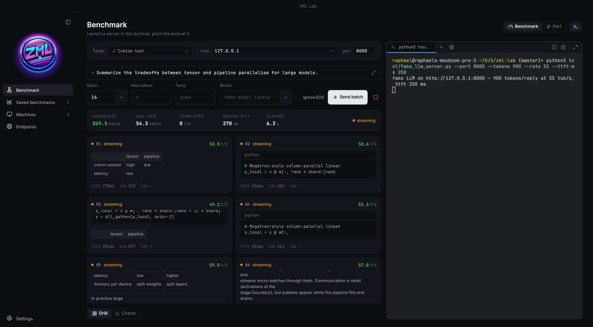
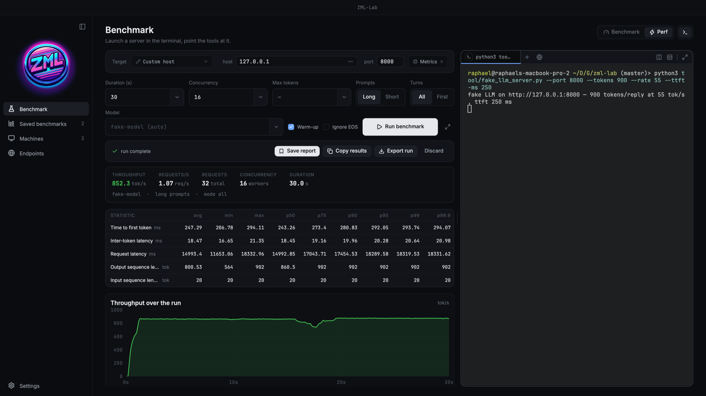
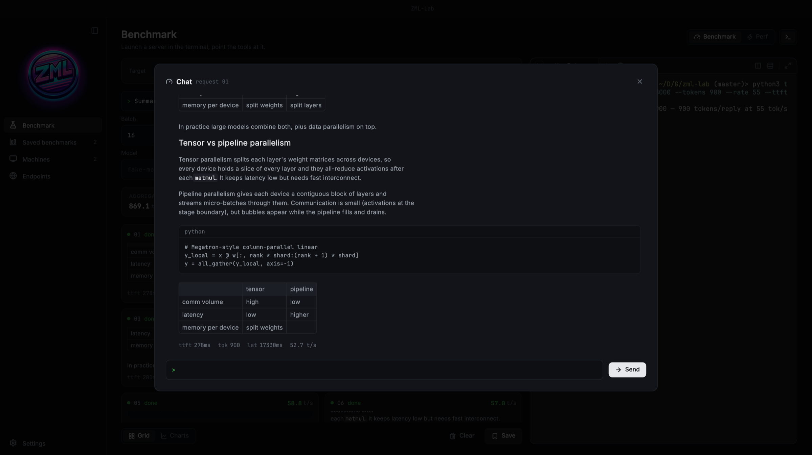

<p align="center">
  
</p>

<h1 align="center">ZML-Lab</h1>

<p align="center">
  A macOS workbench for launching LLM inference servers and measuring them.
</p>

<p align="center">
  <a href="https://github.com/elogir/zml-lab/releases/latest"></a>
  
  <a href="https://flutter.dev"></a>
  <a href="https://dart.dev"></a>
</p>



Start a server in the built-in terminal, point the tools at it, and watch it
work. Built around [llmd](https://github.com/zml/zml), it works with any
OpenAI-compatible endpoint. Get it from the
[latest release](https://github.com/elogir/zml-lab/releases/latest).

## What it does

- **Benchmark**: fires a concurrent batch at `/v1/chat/completions` and
  streams every reply live, with per-request and aggregate tok/s, TTFT and
  rendered markdown. Open any request as a multi-turn chat, switch to charts,
  copy the results or save the run.
- **Perf**: a load test. It replays ShareGPT conversations at a fixed
  concurrency for a set duration, with live throughput and in-flight charts,
  then reports TTFT, inter-token and request latency percentiles. It can also
  show chip metrics from `zml-smi`. Each run is recorded as a
  `.jsonl.gz` file you can export. It's gzipped JSON Lines with every
  chunk's arrival time, so anyone can check the numbers or write one from
  another benchmarker ([format](docs/perf-run-format.md)).
- **Terminal**: a tmux-style multiplexer beside the tools, with tabs, splits
  and web tabs. Each pane is a real PTY running your login shell.
- **Saved benchmarks**: chat benchmarks and perf reports with search,
  filters, sorting, a card or table view and compare. You can also import
  `.jsonl.gz` files.
- **Machines & Endpoints**: the local box and remote hosts, each with a live
  reachability dot, plus saved endpoints (URL and API key) to aim the tools
  at.
- **Updates**: checks GitHub releases and downloads only when you click
  *Update to …*.

## Screenshots





<sub>Screenshots were taken against `tool/fake_llm_server.py`, not a real
model.</sub>

## Build from source

```sh
flutter pub get
dart run build_runner build --delete-conflicting-outputs
flutter run -d macos
```

The Perf tab needs the prebuilt benchmarker library,
`native/libzmlbench.dylib` (see [native/README.md](native/README.md)). To try
the app without a GPU, run `python3 tool/fake_llm_server.py --port 8000` and
point the Benchmark tab at `127.0.0.1:8000`.
